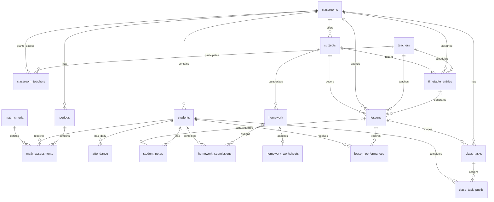

# Teaching data model

The diagram shows application relationships after migration 0007. Audit columns (creator, last editor, timestamps) and authentication tables are omitted. Teachers still have hashed sessions and administrator-issued registration tokens. Classroom membership remains the authorization boundary.

- `timetable_entries` stores the teacher, class, subject, weekday, local start/end time, room and validity dates. A weekly entry materializes its dated lessons in the same transaction. Series are bounded to 366 days and do not require writes during reads.
- `lessons` keeps its own class, subject, teacher, date, times, room, topic, goals and scheduled/cancelled status. `scheduled_date` identifies the original occurrence even after it is moved. Individual changes do not rewrite the rest of a series.
- `lesson_performances` is unique per `(lesson_id, student_id)` and contains a rating from 1–4 plus an optional observation. Composite foreign keys enforce that lesson and pupil belong to the same class.
- `student_notes.lesson_id` is optional. Existing notes stay independent of lessons. Creation checks both pupil and lesson against the requested class, while editing preserves the original context and creation date.
- `class_tasks` contains the required class, optional lesson, title, description, due date and `once`/`per_pupil` completion mode. One-off completion is stored on the task. The mode and lesson association are stable after creation.
- `class_task_pupils` snapshots pupil assignments and stores individual completion times. Counts are derived, so corrections and pupil deletion cannot leave cached completion counts stale.
- `attendance` remains unique per `(classroom_id, attendance_date, student_id)`. A lesson supplies the class and date without duplicating daily attendance records.
- `periods` and `math_assessments` retain their existing meaning. Lesson ratings and competency achievements are independent.

All dates/times used in lesson selection and the dashboard are local school-day values. Authentication and audit timestamps remain Unix timestamps. Materials reuse the private homework worksheet blobs and their existing access checks.
